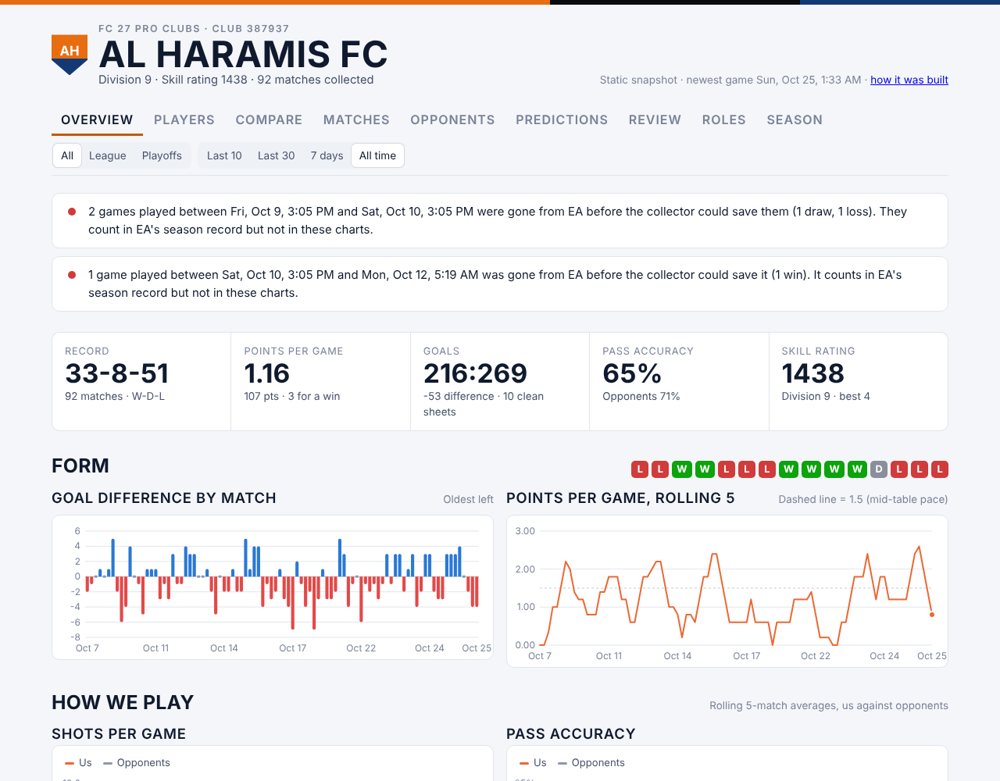
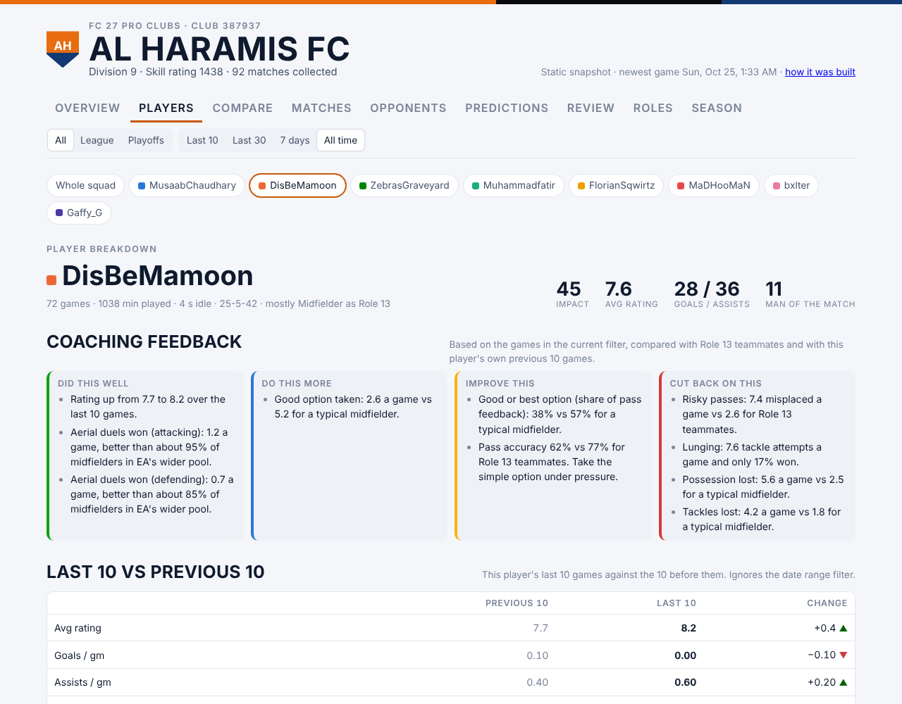
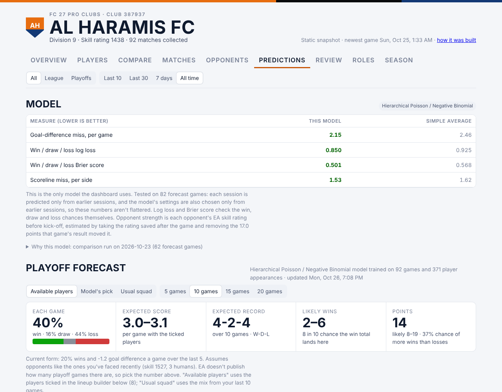

# Pro Clubs performance tracker (EA FC 27)

How does a Pro Clubs team of friends actually play, what goes with winning, and where can each player improve?

This project collects every league and playoff game of **Al Haramis FC** (EA SPORTS FC 27 Pro Clubs, club 387937) from EA's public match records within an hour or so of the game. It then analyses them at team and player level.

The data runs from 7 to 24 October 2026 and covers 92 games, 371 player appearances and about 12,800 in-game event counts. On top of that sit a live dashboard, a match-outcome model with honest walk-forward testing, and per-player coaching notes. The coaching notes benchmark each player against 51,395 player-matches from other clubs.

**New to this? Start with [RESULTS.md](RESULTS.md), a plain-English version of the findings.** [`docs/project_overview.docx`](docs/project_overview.docx) explains the thinking behind the project, what it found, where it goes next, and how it ties into my sports-analytics research goals.



## Headline results

**1. Opponent strength explains most of the results.**

| | Games | Points per game | Goal difference per game |
|---|---|---|---|
| Opponent in the weaker half (pre-game skill rating under 1,498) | 46 | 1.65 | +0.72 |
| Opponent in the stronger half (1,498 or more) | 46 | 0.67 | −1.87 |
| More human players than the opponent | 47 | 1.60 | +0.36 |
| Fewer human players than the opponent | 23 | 0.57 | −1.74 |

Some factors overlap: games where we had more players were often against weaker clubs. A regression with all of them together separates their effects. Each +100 points of opponent skill rating costs **0.87 goals of goal difference** (standard error 0.19). An extra human player over the opponent adds about +0.24 goals (±0.16), which is positive but not clearly different from zero. Any fatigue across a long session is too small to measure: −0.13 goals per later game (±0.16).

**2. Same shots, fewer goals.** We out-shoot opponents slightly, 7.0 shots a game to their 6.4. But opponents score 45.8% of their shots and we score 33.6%. They also complete 71% of their passes to our 65%.

**3. Decisions and positioning are the clearest team weakness.** These figures come from EA's in-game feedback counters, across 295 appearances from 10 October onwards. Each is compared with the median player at the same position in a community dataset:

| | Al Haramis | Typical player, same positions |
|---|---|---|
| Good or best passing option taken | 48% | 63% |
| In position when prompted | 69% | 88% |
| Possession lost per game | 4.0 | 3.1 |

Decision quality does not move with the stakes. It is 48% in league games and 49% in playoff games. Positioning does slip: it falls from 74% in the first two games of a night to 65% from the fifth game on, and to 65% in playoffs. See [`results/decisions_under_pressure.csv`](results/decisions_under_pressure.csv).

**4. Crediting individuals is hard with this much data.** The team's goal difference is compared with and without each player, after allowing for the opponents each one happened to face. Most regulars are within about one standard error of zero. The exception is one forward: games with him go +1.16 goals better than games without him (±0.52, 28 games). That is a little over two standard errors, but with seven players tested, one result that size could be chance. See [`results/squad_table.csv`](results/squad_table.csv).

**5. The prediction model beats the club's average, modestly but consistently.** The model is a hierarchical Poisson / negative binomial goals model. To test it, every session is predicted using only earlier sessions: 82 forecast games so far.

| | Model | Club's average so far |
|---|---|---|
| Win / draw / loss log loss | 0.850 | 0.925 |
| Brier score | 0.501 | 0.568 |
| Average miss on goal difference | 2.15 goals | 2.46 goals |
| Results called right | 50 of 82 (61%) | 43 of 82 (52%) |

The player-level forecasts (each player's average, shrunk towards the squad's) are no better than each player's own running average yet.

Per-player strengths and things to work on are in [RESULTS.md](RESULTS.md#each-player) and [`results/player_coaching_notes.csv`](results/player_coaching_notes.csv).

## A lesson in leakage

The first model was XGBoost. It used each opponent's EA skill rating as saved *after* the game. On 64 games it beat the club average (2.08 vs 2.19 goals of goal difference).

The problem was that a club's rating moves with every result. Beating a team lowers its rating, so the post-game rating quietly told the model who had won.

The fix was to estimate each opponent's rating *before* kick-off. That is the rating saved after the game, minus the swing that game's result gave it. From our own daily snapshots, the swing is 17 points per result.

The models were then compared again on 72 games (62 forecasts), with each model's settings also chosen only from earlier sessions. XGBoost fell to the level of the simple average (log loss 0.924 for both). The Poisson model was best (0.873), ahead of a Bradley-Terry rating updated by a Kalman filter (0.883).

The descriptive results above use the same pre-game estimate. The figures behind that comparison are recorded in [`model/train_model.py`](model/train_model.py) (`SELECTION`). The first model's code is kept in [`model/archive/`](model/archive/).

## The dashboard

The live dashboard has nine tabs: overview, players, club comparisons, match log, opponents, predictions (with a lineup builder), model review, roles and EA's season totals. It refreshes itself whenever the collector saves new games.

[`docs/index.html`](docs/index.html) is a static copy with this repo's data baked in. Open it in a browser, or serve `docs/` with GitHub Pages.

| Player breakdown | Predictions |
|---|---|
|  |  |

## How the data is collected

EA's Pro Clubs API (`proclubs.ea.com/api/fc/`) is public but unofficial and undocumented. It only keeps a club's most recent games, so anything not saved within a day or so is gone for good. The collector therefore runs on a schedule built around when the team plays:

- hourly from 10 PM to 3 AM Pakistan time every night
- hourly from 10 AM to 9 PM Friday to Sunday
- two catch-up runs on weekday mornings

Each run:

1. **Saves new games.** It reads the league and playoff match lists (`clubs/matches`) and saves any game not already stored. For each game it keeps every player's line, EA's event counters, the opponent's player lines, the opponent club's record and its skill rating right after the game.
2. **Checks that the player lines add up** to EA's club totals for shots, passes, tackles and goals. A game that fails is fetched again. If it still fails, it is stored with an `unverified` flag. Two of the 92 carry the flag: one where player goals summed to 3 against EA's total of 4, and one where EA's response was cut off. In 12 games, a player whose event counters looked wrong was saved without them.
3. **Checks the lists are fresh.** EA's content-delivery network serves cached copies that can be hours old. Its cache ignores a parameter named `_` but not one named `cb`, so every URL carries `cb=<unix time>`. Each run also compares the opponents of the five most recent games (`lastOpponent0..4` in `clubs/overallStats`) with the saved games. If they don't match, the lists were stale, so they are fetched again with a new cache-buster. Before this check, cached lists hid playoff games on 16 October. They were recovered by asking EA for up to 20 results (`maxResultCount=20`).
4. **Saves a daily snapshot** of EA's own club totals and member stats.
5. **Retrains the model** and rebuilds the model review whenever new games arrive.

**Missed games.** EA's running record shows 90 games since the first snapshot, and 87 were captured, so 3 were missed. The draw and the loss were on 9 October, and the win was between 10 and 12 October, all before the hourly evening schedule began. Some snapshots are themselves stale cached copies, so the check only counts a new high in the shortfall. See [`results/missed_games_check.csv`](results/missed_games_check.csv).

**What collected this data.** A scheduled Claude task collected the data in `data/raw/`. It read EA through a web-fetch tool, because its sandbox could not reach EA directly, and wrote to the dashboard's database.

[`collector/collect.py`](collector/collect.py) is a standalone port of the same steps and checks that talks to EA directly over HTTP, so the pipeline can run anywhere. Its parsing is tested by rebuilding an EA-shaped response for each of the 69 complete games with opponent lines. Every one comes back identical to what was saved, including all event counters. The port itself **has not been run against the live EA API** from this repo's build environment, and EA may reject requests that don't look like they come from a browser.

## Method

1. **Unit of analysis.** A game, and a player's appearance in a game. Only appearances with game time count: 371 of 379. Team shot, pass and tackle figures cover human players only. Goals include the 9 of 216 scored by AI teammates.
2. **Sessions and seasons.** A gap of more than 45 minutes between kick-offs starts a new session; there are 14. A season ends when its playoff run is over. Season 1 ran from 7 to 19 October (55 games). Season 2 has 37 games so far.
3. **Opponent strength.** Each opponent's EA skill rating before kick-off, estimated as described above. 72 games have a rating saved right after the game. 20 fall back on the club's latest saved record, and those are less exact.
4. **What goes with winning.** Points and goal difference are grouped by opponent strength (split at the median of 1,498), by the number of human players on each side and by game number within a session. An ordinary least-squares regression of goal difference on all of these together separates their effects ([`results/goal_difference_regression.csv`](results/goal_difference_regression.csv)).
5. **Players.** Per-game rates, shot conversion, pass and tackle success, and the team's record with and without each player. "Vs expected" subtracts what the opponent's skill rating alone predicts, with a Welch standard error on the difference. Trends compare each player's first half of games with his second half, alongside how strong the opponents were in each half.
6. **Event counters.** EA's `match_event_aggregate` fields hold numbered counters, for example code 0 = tackles won, 6 = interceptions, 111 = a good positioning prompt and 176/177 = a good or best option taken. Their meanings, and the benchmarks by position, come from the community research at [Interactive-63/eafc-pro-clubs-api-research](https://github.com/Interactive-63/eafc-pro-clubs-api-research). The benchmarks give the 10th to 90th percentiles per position, from 51,395 player-matches across 4,277 clubs between 17 and 19 September 2026. A player's percentile is placed by linear interpolation between those quantiles, at his most common position in games with event data. Every code used is one that research rates high confidence. Strengths are metrics in the top quarter, and things to work on are metrics in the bottom quarter. Style-only counts, such as shots off target, are left out.
7. **Model** ([`model/train_model.py`](model/train_model.py)). Goals for and goals against are each modelled as counts. The inputs are a regularised effect for each regular player, the counts of humans by position on each side, pre-game opponent skill and playoff or league. The model uses a negative binomial when scores are more spread out than a Poisson allows. The shrinkage strength is chosen by log loss on earlier sessions only. Win, draw and loss chances come from the two goal distributions. [`model/review_model.py`](model/review_model.py) replays the whole history the same way, and matches each forecast the dashboard published to the games that followed it.

## Limitations

- **Small sample.** 92 games, 14 sessions and 6 to 7 regular players. The standard errors above are wide, and the individual player effects are mostly within noise.
- **Pre-game ratings are estimates.** The swing per result is an average from our own snapshots, and 24 games rely on a rating saved more than a day after the game.
- **The event benchmarks are not a perfect match.** The community dataset is a September 2026 sample of other clubs, averaged per player. Our numbers are per game, at whatever position EA logged, and EA's position labels are broad.
- **The event-code meanings are community-decoded,** not published by EA.
- **Opponent line-ups start on 12 October**, and event counters on 10 October.
- **Three games were missed** (see above), and the 54 games played before collection started can't be recovered.
- **Correlation, not cause.** Numbers advantage, session fatigue and player effects are all tangled up with who we happened to play. The descriptive splits show what went with winning, not what caused it.

## Reproduce

```bash
pip install -r requirements.txt
bash scripts/reproduce.sh
```

That runs, in order:

```bash
python src/build_tables.py data/raw data/processed            # raw EA documents -> CSV tables
python model/train_model.py data/raw results/model/model_latest.json    # about 30 seconds
python model/review_model.py data/raw results/model/review.json
python src/analyze.py data/raw data/processed results          # tables, charts, results/headline.json
python dashboard/build_static.py data/raw results/model docs/index.html
python -m unittest discover -s tests
```

Reruns match the files in `results/` exactly, apart from timestamps. Every number quoted in this README and in RESULTS.md is in [`results/headline.json`](results/headline.json) or the CSVs next to it.

To collect games for your own club, run `python collector/collect.py --club <your club id> --out data/raw` on a schedule. See the caveat above.

## Repository layout

```
data/raw/          EA documents as saved: matches, opponent line-ups (oppmatch), opponent clubs,
                   opponent rating after each game (oppskill), daily club snapshots, published
                   model runs, benchmark clubs and event benchmarks
data/processed/    flat CSVs: matches, player appearances (with event metrics), opponent appearances,
                   every raw event count, snapshots
src/               build_tables.py, analyze.py
model/             train_model.py (the model), review_model.py (backtest), archive/ (first XGBoost model)
collector/         collect.py, standalone collector
dashboard/         the dashboard's source and the static build script
docs/              static dashboard (index.html), screenshots, project_overview.docx
results/           tables (CSV), figures (PNG), model outputs, headline.json
tests/             collector parsing and saved-data integrity tests
```

## Data sources and credits

- Match, player, club and member data come from the EA SPORTS FC Pro Clubs public web API (`proclubs.ea.com`). It is unofficial, and this project is not affiliated with or endorsed by EA. Player names are public EA gamertags, as they appear in that data.
- Event-code meanings and positional benchmarks come from [Interactive-63/eafc-pro-clubs-api-research](https://github.com/Interactive-63/eafc-pro-clubs-api-research). Only the code meanings and summary quantiles are used here, with thanks.
- Built with AI assistance. The scheduled collector runs as a Claude (Anthropic) task, and the code, dashboard and write-ups were developed with Claude.
