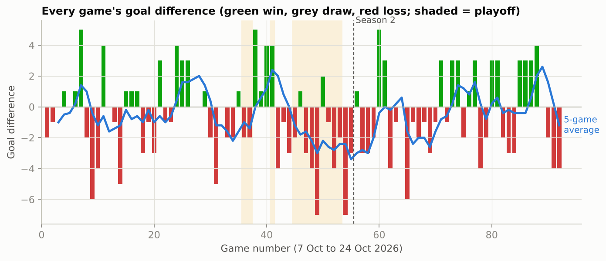
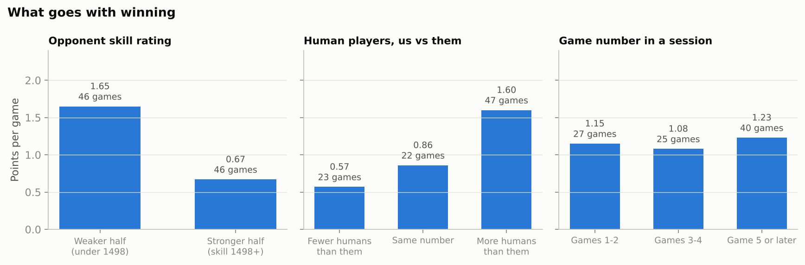
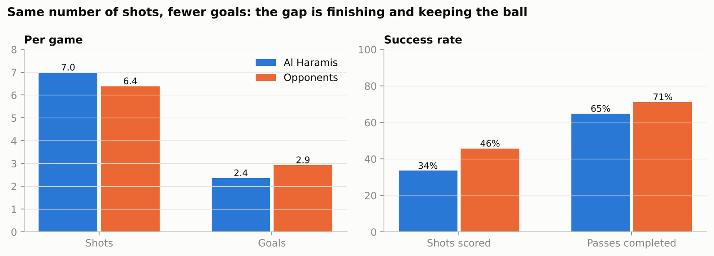
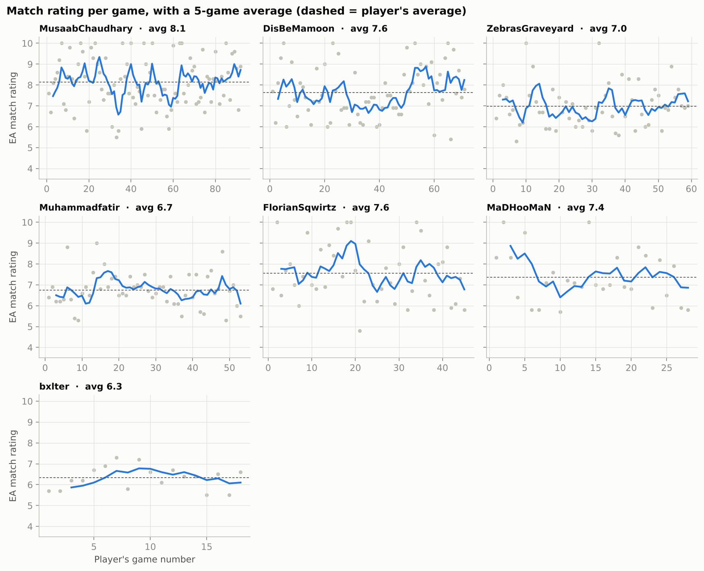
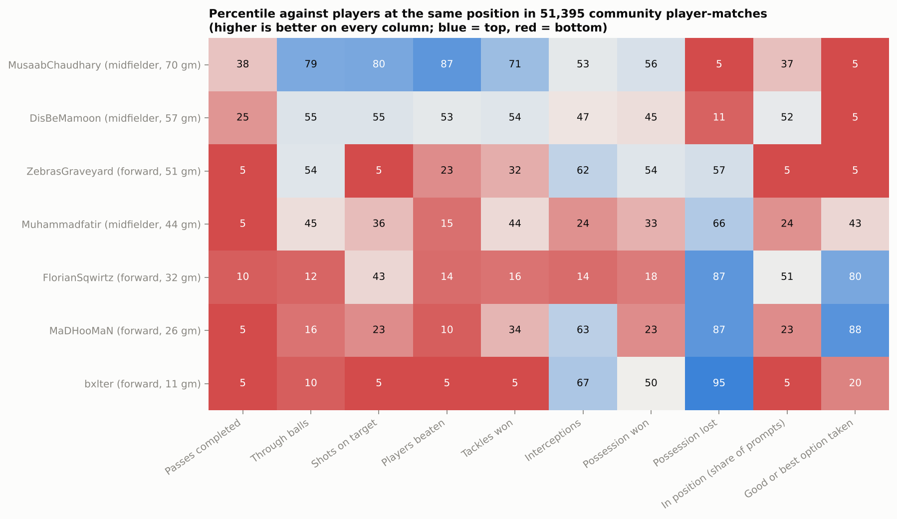
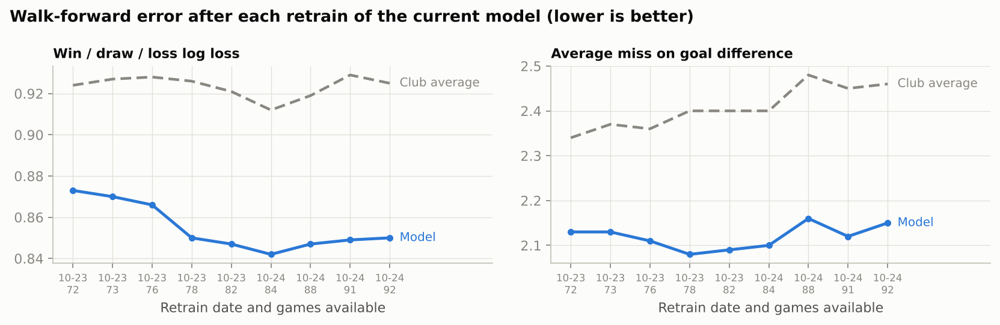

# What the numbers say, in plain English

This is the readable version of the analysis. The [README](README.md) has the method and the caveats. Every number here is in [`results/headline.json`](results/headline.json) or in the CSV tables in [`results/`](results/).

**The data:** 92 games played by Al Haramis FC between 7 and 24 October 2026. That is 80 league and 12 playoff games, over 14 evenings of play. The overall record is 33 wins, 8 draws and 51 losses, which is 1.16 points per game. We scored 2.35 goals a game and conceded 2.92.

There have been real high points:

- 13 October: 4 wins and 2 draws from 6 games.
- 15 October: three straight wins after two playoff losses.
- 23 October: the best night so far, 6 wins from 10 games and +6 goal difference.

The worst stretches were the late playoff games on 16 October and the nights of 19 and 22 October. The 5-game average has ranged from −3.4 to +2.6 goals. Season 2 (from 19 October) is running at 1.19 points a game, much like season 1's 1.15.

## What goes with winning

**Who we play matters most.** Opponent strength here is each club's EA skill rating before kick-off. Against the weaker half of opponents, we average 1.65 points a game and win by about 0.7 goals. Against the stronger half, we average 0.67 points and lose by almost 2 goals a game. Every 100 points of opponent rating is worth close to a goal of goal difference.

**Having more humans than the other team helps a little.** On its own, it looks big: 1.60 points a game against 0.57. But games where we outnumbered the opposition were often against weaker clubs. Once opponent strength is taken into account, the extra human is worth about a quarter of a goal. That is too small to be sure it's real with this many games.

**We don't clearly fade over a long session.** Games 3 and 4 of a night were slightly worse on average, but games from the fifth onwards were as good as the start.

## How we play

- **We create at least as much as opponents.** We average 7.0 shots a game to their 6.4.
- **They finish better.** Opponents score 46% of their shots and we score 34%. Finishing at their rate would be worth about 0.8 goals a game. Two of our regular forwards also put far fewer shots on target than typical forwards.
- **They keep the ball better.** They complete 71% of their passes and we complete 65%. We lose possession 4.0 times per player per game, where a typical player at the same position loses it 3.1 times.
- **Decision-making is the biggest gap.** EA's in-game feedback pops up when a player takes the best option, takes a good option, or should have passed elsewhere. Our players took a good or best option 48% of the time, against 63% for a typical player at the same positions. They were in position when prompted 69% of the time, against 88%.

**Pressure doesn't change the decisions, but late nights hurt positioning.** Decision quality is the same in league and playoff games (48% and 49%) and against weaker and stronger opponents (50% and 47%). Positioning is what slips. It falls from 74% in the first two games of a night to 65% from the fifth game on, and it is 65% in playoff games. Part of that may be who plays late. Long sessions also have bigger squads: 4.8 of our players per game from the fifth game on, against 3.3 in the first two.

Put simply, we get into games as often as opponents. We lose them by giving the ball away with rushed or wrong passes, and by not being back in position when we do.

## Each player

The table covers players with at least 10 games. "Team points with" is the team's average when that player played. "Vs expected" takes out the effect of the opponents each player happened to face, and the ± is its standard error.

| Player | Games | Main positions | Avg rating | Goals + assists / game | Pass completion | Team points / game with them | Goal diff with vs without, vs expected |
|---|---|---|---|---|---|---|---|
| MusaabChaudhary | 92 | midfield, forward, defence | 8.1 | 1.19 | 64% | 1.16 | (every game) |
| DisBeMamoon | 71 | midfield, forward | 7.6 | 0.90 | 62% | 1.08 | −0.47 ± 0.51 |
| ZebrasGraveyard | 59 | forward, midfield | 7.0 | 1.00 | 61% | 1.20 | +0.50 ± 0.51 |
| Muhammadfatir | 53 | midfield, forward | 6.8 | 0.49 | 63% | 1.32 | +0.34 ± 0.53 |
| FlorianSqwirtz | 45 | forward | 7.6 | 1.47 | 79% | 1.33 | +0.67 ± 0.51 |
| MaDHooMaN | 28 | forward | 7.4 | 1.29 | 76% | 1.79 | +1.16 ± 0.52 |
| bxlter | 18 | forward | 6.3 | 0.50 | 61% | 1.00 | −0.88 ± 0.65 |

**Nobody can yet be shown to be carrying or holding back the team.** Most differences are about one standard error from zero. MaDHooMaN's is the largest: the team goes a goal better than expected with him. That is a little over two standard errors, but with seven players tested, one result that size can turn up by chance. It is worth watching as more games come in.

**Who is improving?** Comparing each player's first half of games with his second half (see [`results/player_trends.csv`](results/player_trends.csv)):

- **DisBeMamoon:** rating up from 7.45 to 7.81 against opponents of similar strength (about 1,500), the clearest improvement in the squad.
- **ZebrasGraveyard:** rating up from 6.86 to 7.11, but against weaker opponents in the second half.
- **FlorianSqwirtz and MaDHooMaN:** both dipped (7.79 to 7.33 and 7.55 to 7.16), but both faced opponents about 130 skill points stronger, which could account for it.
- **MusaabChaudhary:** steady at 8.14 in both halves.

**Where each player stands against players in the same position elsewhere.** These are percentiles in a community dataset of 51,395 player-matches. Higher is better on every column, and 50 is typical. A value of 5 or 95 means outside the 10th to 90th percentile range.

What that means for each regular (from [`results/player_coaching_notes.csv`](results/player_coaching_notes.csv)):

- **MusaabChaudhary** (midfield, 70 games with event data). The creator, and the most involved player in the team.
    - **Strengths:** around the top fifth of midfielders for players beaten (4.4 a game against 2.2 for a typical midfielder), shots on target (1.4 against 0.7) and through balls (6.4 against 4.0).
    - **Work on:** losing the ball (6.5 a game against 2.5, bottom 10%) and choosing the simpler option (43% good or best decisions against 57%). He misplaces 5.9 forward passes a game against 3.6 for a typical midfielder, so many of those losses come from forcing the ball forward.
- **DisBeMamoon** (midfield, 57 games). Close to typical on almost everything: through balls, shots on target, players beaten, tackles and positioning are all between the 45th and 55th percentiles.
    - **Work on:** decisions (a good or best option only 38% of the time, against 57%, bottom 10%) and ball losses (5.6 a game, against 2.5). Both share a cause with Musaab's: forward passes that don't come off (5.5 a game).
- **FlorianSqwirtz** (forward, 32 games). The best finisher and one of the best decision-makers.
    - **Strengths:** a good or best option 77% of the time (80th percentile of forwards), only 2.0 ball losses a game, 79% passing and 1.16 goals a game.
    - **Work on:** involvement. He completes 8.5 passes a game against 13.6 for a typical forward, plays few through balls and does little without the ball (interceptions and possession won are both in the bottom fifth).
- **MaDHooMaN** (forward, 26 games). Similar to Florian.
    - **Strengths:** good decisions (80%, 88th percentile), rarely loses the ball (2.0 a game) and scores 1.04 goals a game.
    - **Work on:** getting on the ball more (6.3 completed passes a game, bottom 10%) and positioning (in position 78% of the time, against 93% for a typical forward).
- **ZebrasGraveyard** (forward, 51 games). Creates for others, with 0.63 assists a game.
    - **Work on:** positioning (in position only 34% of the time when prompted, against 93% for a typical forward), shots on target (0.9 a game against 2.2) and involvement in build-up (8.0 completed passes a game against 13.6).
- **Muhammadfatir** (midfield, 44 games). Keeps the ball reasonably well (2.0 losses a game, against a typical 2.5).
    - **Work on:** getting on the ball (7.0 completed passes a game against 15.7 for a typical midfielder, bottom 10%), positioning (66% against 82%) and beating players.
- **bxlter** (forward, 11 games with event data). Rarely gives the ball away.
    - **Work on:** everything involving the ball. Completed passes, shots on target and players beaten are all in the bottom 10% of forwards, partly because he gets fewer touches. He is also often out of position.

Gaffy_G has only 5 games, which is too few to read much into.

## Can the results be predicted?

Yes, a bit better than guessing from our average. The model looks at:

- who is playing, and in which positions
- the opponent's pre-game skill rating
- how many humans each side has
- league or playoff

Replayed fairly, with every session predicted only from earlier ones (82 games so far):

- It called **50 of 82 results right (61%)**. Guessing from the club's record so far called 43 (52%).
- Its win, draw and loss chances score better on every standard measure: log loss 0.850 against 0.925, and Brier score 0.501 against 0.568.
- It missed the goal difference by **2.15 goals a game on average**, against 2.46 for the average guess.
- It expected **89 points** from those games, and we got **96**. When it gave us under a 30% chance of winning, we won 25% of the time (32 games). At 30 to 50%, we won 41% (46 games). It has slightly underrated us lately.

**An honest correction along the way.** The first model (XGBoost) looked good, but it was using opponents' ratings saved *after* each game. A club's rating drops when it loses, so those ratings quietly gave away the result. Once ratings were rolled back to before kick-off, XGBoost was no better than the average guess. The simpler goals model above became the one the dashboard uses.

Predicting individual stats, such as a player's rating, goals or passes, is no better than using his own average so far. Ninety games is not enough for that.

## Missing games

EA's own running record counts 90 games since collection started, and 87 of them were saved. The 3 that slipped through (a win, a draw and a loss) were in the first days of collection, before the hourly evening schedule. The 54 games played before collection started can't be recovered, because EA only keeps recent matches.

## The short version

1. Results mostly track how strong the opponent is: about a goal of goal difference per 100 rating points.
2. We create as many chances as opponents. We lose games on finishing, keeping the ball and decisions.
3. The single most useful habit for most of the squad: take the simple, safe option more often, and get back into position, especially late in long sessions.
4. Once you allow for opponents, nobody is clearly carrying the team or holding it back. With more games, MaDHooMaN's positive effect is the one to watch.
